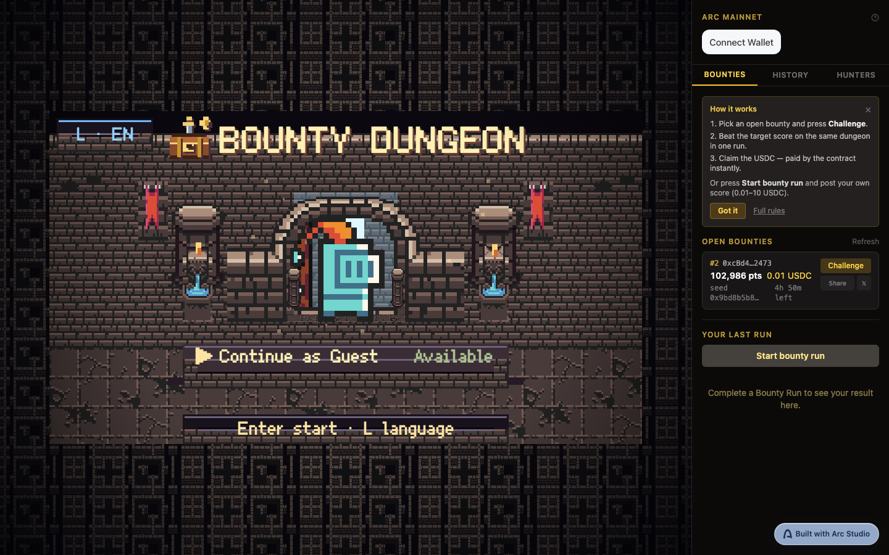
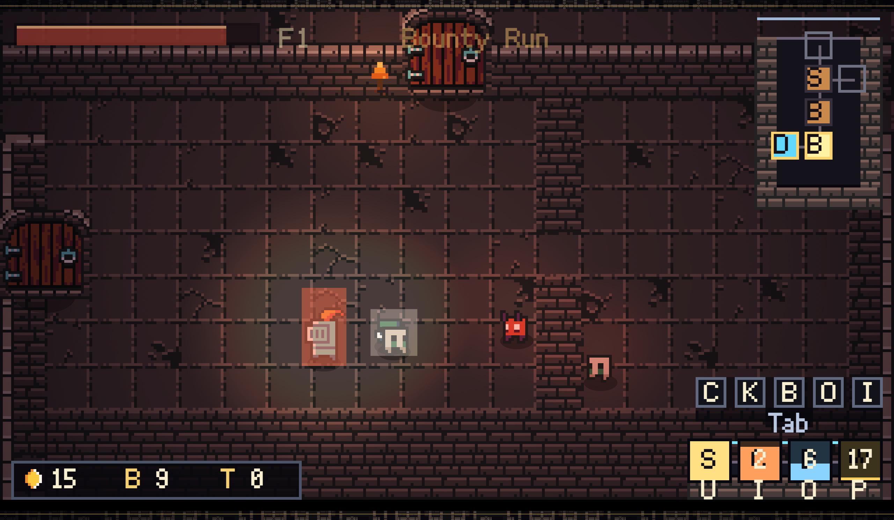
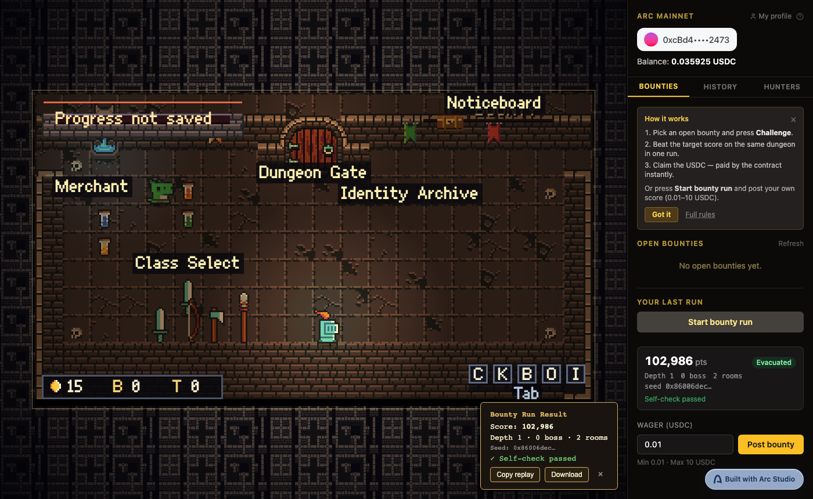
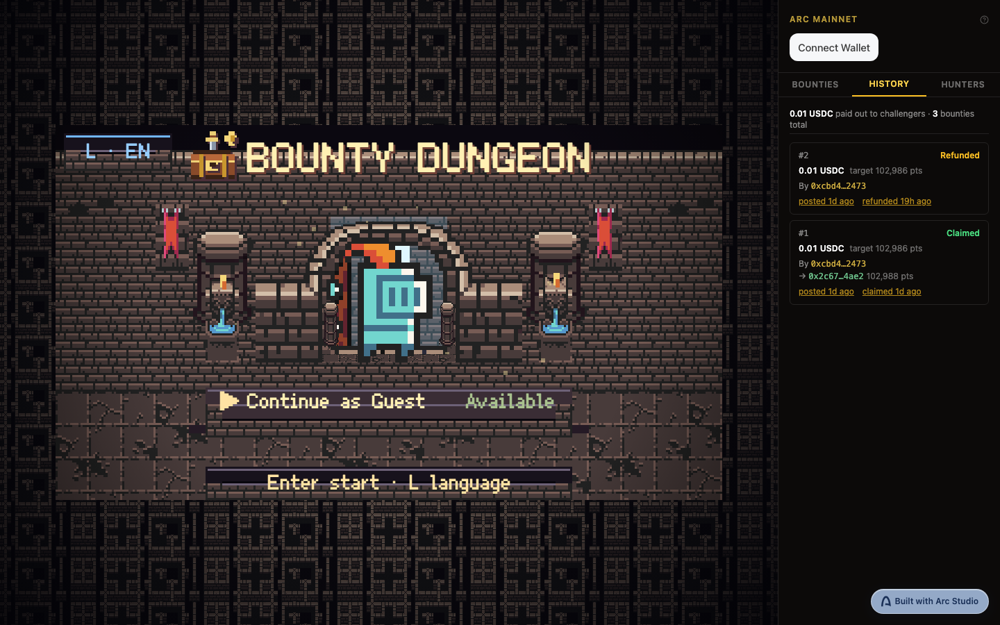

# Bounty Dungeon

**Beat my run, take my USDC.** A pixel roguelike where any player can post a USDC bounty on a run they just finished. Challengers replay the **exact same dungeon seed**. The first one to score strictly higher within 24 hours is paid by the contract. If nobody beats it, the poster takes the bounty back.

- **Play:** https://bounty-dungeon.vercel.app (Arc mainnet, real USDC)
- **Contract:** [`0x53b8512e4124089c88aab379c64cb8dc05b344ba`](https://explorer.arc.io/address/0x53b8512e4124089c88aab379c64cb8dc05b344ba) on Arc mainnet (chain 5042)
- **Built with:** Arc Studio. Contract, tests, web app, verifier and history indexer were written in Studio; see [Built with Arc Studio](#built-with-arc-studio).

---

## 玩法

打开 [Bounty Dungeon](https://bounty-dungeon.vercel.app)，选择 **Continue as Guest**，按 `Enter` 进入游戏。游客可以探索地牢，也可以在右侧查看开放悬赏、**History**（历史记录）和 **Hunters**（猎人榜）。要发布悬赏、领奖或发起退款，请连接钱包并切到 **Arc 主网**，备好支付链上手续费的 USDC。

### 挑战悬赏

1. 在 **Open bounties** 中选一条悬赏，查看目标分数、奖金和剩余时间，再点 **Challenge**。游戏会加载这条悬赏的地牢种子。
2. 完成一局并拿到**严格高于**目标的分数。结算后，在右侧点 **Claim bounty**，等待服务端回放验分，再在钱包确认领取交易。
3. 24 小时有效期内，首位成功领取的挑战者会收到合约托管的 USDC。

### 发布悬赏

1. 点 **Start bounty run** 开一局。结算后，在 **Your last run** 中确认成绩。
2. 输入 **0.01–10 USDC**，点 **Post bounty**。如果钱包需要先授权 USDC，确认授权后继续确认发布交易。交易成功后，合约托管奖金，本局成绩成为挑战目标。
3. 在悬赏卡上点 **Share**，把这条悬赏的挑战链接发给朋友。

如果 24 小时内无人领取，任何已连接钱包的用户都可以点击 **Refund to poster**，奖金会退回发布者的钱包。

**操作键**　`WASD` 或方向键移动，`J` 或空格攻击，`K` 闪避，`U`/`I`/`O`/`P` 施放技能，`E` 交互，`L` 切换中英文。

### 实机截图

| 入口与悬赏列表 | 地牢战斗 |
| --- | --- |
| [](docs/screenshots/bounty-board.png) | [](docs/screenshots/dungeon-combat.png) |

| 发布悬赏 | 悬赏历史 |
| --- | --- |
| [](docs/screenshots/post-bounty.png) | [](docs/screenshots/bounty-history.png) |

---

## How it works

```
 player finishes a run                       challenger replays the same seed
        │                                                  │
        ▼                                                  ▼
  input log + seed ──► /api/verify ◄────────────── input log + seed
                       re-simulates the run
                       with the game's own
                       deterministic engine
                            │ EIP-712 RunResult(player, seed, score, replayHash, runId)
                            ▼
              DungeonBounty.postBounty()        DungeonBounty.claimBounty()
              locks USDC, target = score        pays if seed matches and
              deadline = now + 24h              score > target
                            │
                            └── after 24h with no winner: refund() → USDC back to poster
```

- **Deterministic simulation.** Combat, movement and dungeon generation run in a seeded, fixed-step simulation (`Arc-Dungeon/apps/web/src/core/simulation`). The browser and the server run the same code, so a run can be checked by replaying its input log. Replays match bit-for-bit across Chromium, Firefox and WebKit in our test harness.
- **Score attestation.** `api/verify.js` (a Vercel function) replays the submitted input log on the server. It rejects runs that are tampered with, incomplete, oversized (over 256 KB) or from an old engine version (`SIM_VERSION`). Only then does it sign an EIP-712 `RunResult`.
- **Escrow.** `DungeonBounty.sol` holds the USDC. It checks the verifier signature, the seed, the deadline and that the score is strictly higher.
- **History indexer.** `api/history.js` scans contract events (`BountyPosted`, `BountyClaimed`, `BountyRefunded`, `ScoreAttested`) from the deploy block onward. It stays inside the public RPC's limits (≤9,000 blocks per call, paced requests, backoff on 429) and caches incrementally. This powers History, Hunters and player profiles.

## Trust model

What the contract guarantees, with no trusted party involved:

- Bounty USDC can only go to a challenger with a valid, strictly higher score on the same seed before the deadline, or back to the poster after the deadline.
- **There is no owner withdraw function.** The owner cannot touch escrowed funds.
- `refund()` can be called by anyone once the deadline has passed, and the funds always go to the poster. A bounty cannot get stuck.
- The poster cannot claim their own bounty (`SelfClaim`), and a run cannot be used twice on the same bounty (`RunIdAlreadyUsed`).
- The poster's target score must also be attested, so nobody can post a fake low target.
- Amounts are bounded on chain to between 0.01 and 10 USDC.

What you have to trust:

- **The verifier key.** Scores are attested by one server-side key (`0xb65C…29c4`). A leaked key could sign fake scores and drain open bounties. Mitigations:
  - Each bounty is capped at 10 USDC and lives for only 24 hours.
  - The key is never in the repo; it lives only in a sensitive (encrypted) Vercel environment variable.
  - Rotating the verifier has a **25-hour timelock**, longer than any bounty's life, and new bounties are paused while a rotation is pending. So a rotation can never change the rules of a bounty that is already open.
- **Roadmap:** multiple independent verifiers (k-of-n signatures), then a proof of the simulation so that no trusted verifier is needed.

## Live on Arc mainnet

| What | Transaction |
| --- | --- |
| Deploy `DungeonBounty` v3 (block 26921133) | [`0xaca6e171…13e8`](https://explorer.arc.io/tx/0xaca6e171b1f34b8fdff0e298230b4541d8bf716905d30533274fa9dbb9e813e8) |
| Approve USDC | [`0xf29d605d…5206`](https://explorer.arc.io/tx/0xf29d605db956905df079fa2c415e81946c05904167256286f23cf28f47345206) |
| Post bounty #1: 0.01 USDC, target 102,986 | [`0x00ec01d0…3c6a`](https://explorer.arc.io/tx/0x00ec01d09d1054be2dd16f4156ee0039439d44171550b777bacead4b99a93c6a) |
| Claim bounty #1: score 102,988, paid 0.01 USDC | [`0x4be71262…d01f`](https://explorer.arc.io/tx/0x4be71262bf36c908c388fbc19ed3254da545b23a678da10c95f57884e769d01f) |
| Post bounty #2: 0.01 USDC, target 102,986 | [`0x5cc2fef6…ac90`](https://explorer.arc.io/tx/0x5cc2fef608d9a3d76b408db36289124cc5ef50766aaaef6d3d4af22c412bac90) |

Every approve, post and claim above went through the live site's UI in a browser. The deploy was done by a script. The full, current list is on the site's **History** tab and at `https://bounty-dungeon.vercel.app/api/history`.

Constructor arguments: USDC `0x3600000000000000000000000000000000000000`, verifier `0xb65C38313bB2aF4c1346E416939658718FE729c4`, owner `0x81d48d2c5D0744e8eF7A5c35cDceB0A27A1c707B`, min `10000` (0.01 USDC), max `10000000` (10 USDC). The deployed runtime bytecode is identical to the Studio-compiled artifact (`contracts/out/DungeonBounty.sol/DungeonBounty.json`) and to the testnet v3 deployment [`0x2ff27f2d…5ce4`](https://explorer.testnet.arc.io/address/0x2ff27f2d99c85926e5f013f1967a94d5a1de5ce4).

## Built with Arc Studio

The whole app was developed in one Arc Studio project, over 20+ agent turns driven from the `arc-studio` CLI:

| Turns | What Studio built |
| --- | --- |
| Contract v1 → v3 | `DungeonBounty.sol` with an EIP-712 verifier, 25-hour verifier timelock and seed-per-bounty design; 46 Foundry tests; testnet deployments |
| Verifier | `api/verify.js`: server-side replay with the game's own headless runner, then EIP-712 signing |
| Bounty UI | React + wagmi panel next to the game iframe: open bounties, approve/post/claim/refund, toasts |
| Gameplay fixes | Foot-based collision (the engine bumped `SIM_VERSION` to "2"), pillar art alignment, settlement screen |
| Visual polish | Crisp pixel rendering at integer scale, brighter lighting, torches, hit sparks; render-only, so replays stay deterministic |
| History & social | `api/history.js` indexer, History / Hunters tabs, player profiles, participation tiers, share links, rules modal |

Done outside Studio, and stated here for transparency:

- **Mainnet deployment.** Studio's deploy tool targets testnet, so the Studio-compiled artifact was deployed with a short viem script. The bytecode is identical, as noted above.
- **Hosting** on Vercel.
- **A few small hotfixes**, applied live first and then sent back to Studio as prompts so the Studio project matches what is deployed.

## Repository layout

```
contracts/                 DungeonBounty.sol + Foundry tests (contracts/test)
src/                       React shell: bounty panel, history, hunters, profiles (wagmi/viem)
api/                       Vercel entry points (re-export Arc-Dungeon/api)
Arc-Dungeon/
  apps/web/                the game (vanilla JS + Canvas, 320×180 pixel art)
    src/core/simulation/   deterministic simulation shared by browser and server
  api/verify.js            score verifier (replay + EIP-712 signature)
  api/history.js           on-chain event indexer
  test/                    427 node tests (sim, replay, verifier, history, UI logic)
  openspec/                specs and change proposals
```

## Run locally

```bash
bun install
(cd Arc-Dungeon && npm run dev)  # game on http://localhost:5174
bun run dev                      # shell + /api/verify + /api/history on http://localhost:5173 (proxies /game)
cd Arc-Dungeon && npm test       # 427 tests
forge install foundry-rs/forge-std --no-git   # once, for the contract tests
bun run contracts:test         # Foundry tests (46)
```

By default the app targets Arc testnet. For mainnet, set `VITE_ARC_NETWORK=mainnet` and `VITE_BOUNTY_ADDRESS`. The verifier needs `VERIFIER_PRIVATE_KEY`, `CHAIN_ID` and `BOUNTY_CONTRACT` in the server environment. The history indexer also reads `BOUNTY_DEPLOY_BLOCK`. Never commit keys.

## Credits

Built on top of an earlier pixel roguelike of ours; the game code lives in `Arc-Dungeon/` (folder name kept from its testnet edition for path compatibility). The Bounty Dungeon chest-and-sword logo is an original pixel mark. Pixel art tiles come from the 0x72 dungeon tilesets; the original asset and vendor licenses are kept under `Arc-Dungeon/apps/web/assets` and `Arc-Dungeon/apps/web/vendor`.

## Disclaimer

Bounty Dungeon is an independent project built on Arc. It is not affiliated with, sponsored or endorsed by Circle or Arc. "Arc" and "Arc Studio" are used only to describe the network and tools the project runs on.
