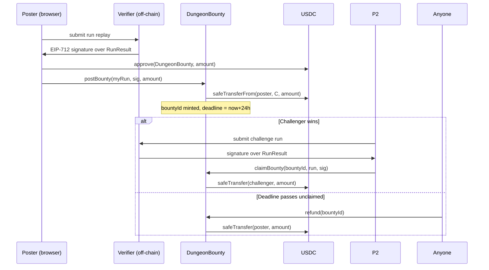

# DungeonBounty — Smart Contract Design Doc

**Status:** Draft  
**Authors:** Arc Studio  
**Target chain:** Arc Testnet (chain ID 5042002, Paris EVM)  
**Language/toolchain:** Solidity 0.8.28, Foundry (forge 0.2.x)  
**Milestone:** v3 — seed-per-bounty  
**Active address (v3):** `0x2ff27f2d99c85926e5f013f1967a94d5a1de5ce4`  
**Deploy tx (v3):** `0x5b5414a3f1a3e837741657c71a1205aae8267a139a91dc28adddadcef0093837`  

### Review tracker

- [ ] Design review
- [ ] Security review
- [ ] Ops review

---

## 1. Action Items (living)

_Empty — fill after review rounds._

---

## 2. Goals / Non-Goals

### Goals

- Let a player stake USDC on their own dungeon score: "Beat my score within 24 h and take the USDC; if nobody does I get it back."
- Attestations are produced off-chain by a trusted verifier that replays the deterministic run replay.
- Daily seed derived entirely on-chain: `keccak256(abi.encode("arc-dungeon", dayId))` where `dayId = floor(block.timestamp / 1 days)`.
- Minimal, immutable escrow logic with no house fee.
- Gas abstraction-friendly: only USDC ERC-20 transfers; no native-value (`msg.value`) paths.

### Non-Goals

- **Not gambling.** A poster can only get their own funds back — not more. There is no house pool and no entry fee.
- No upgradability, no proxy.
- No on-chain replay/verification — the verifier is a trusted off-chain process.
- No leaderboard storage on-chain (events are the leaderboard source).
- No multi-token support; USDC only (hardcoded at deploy time).
- No frontend (separate deliverable).

---

## 3. Requirements

### Functional

- F1: Any address may post a bounty for any `bytes32 seed` with 0.1–10 USDC (owner-configurable bounds).
- F2: A bounty has a fixed 24-hour deadline from posting time.
- F3: A different address may claim a bounty before its deadline if their verified score exceeds the poster's target score AND was played on the same seed (`run.seed == bounty.seed`).
- F4: After the deadline, if unclaimed, anyone may trigger a refund to the poster.
- F5: Only one claim per bounty; first valid claim wins.
- F6: Owner can rotate the verifier address and adjust the USDC amount bounds.
- F7: Owner can never withdraw or redirect escrowed USDC.

### Security

- S1: No path lets a non-verifier signature pass attestation validation (EIP-712 domain includes chainId + contract address).
- S2: No path lets the poster claim their own bounty.
- S3: No path lets a replay of a signature work on a different contract or chain (domain separator).
- S4: A runId cannot be used twice (replay guard per bounty).
- S5: Reentrancy-safe: state written before external calls.
- S6: Integer arithmetic safe (Solidity 0.8 checked math throughout).
- S7: No path moves escrowed funds except `claimBounty` (to the claimer) and `refund` (back to the poster).
- S8: Zero-address checks on constructor args and sensitive setters.

---

## 4. Terminology & Actors

| Term | Definition |
|------|-----------|
| `seed` | `bytes32` — arbitrary map seed chosen by the poster; challengers must use the same seed |
| `RunResult` | Typed struct: `(address player, bytes32 seed, uint64 score, bytes32 replayHash, bytes32 runId)` |
| Bounty | A posted wager: target score, USDC amount, deadline, poster, status |
| Poster | Address that calls `postBounty` |
| Claimer | Address that calls `claimBounty` with a run that beats the target |
| Verifier | Trusted off-chain EOA that signs `RunResult` attestations |
| Owner | Contract owner; rotates verifier and adjusts amount bounds |

| Actor | On/Off-chain | Trust | Capabilities |
|-------|-------------|-------|-------------|
| Owner | Off-chain EOA | Trusted | Rotate verifier, set amount bounds |
| Verifier | Off-chain EOA (replay service) | Semi-trusted | Sign `RunResult` attestations; cannot move funds |
| Poster | On-chain EOA/SCA | Untrusted | Post bounties for their own run |
| Claimer | On-chain EOA/SCA | Untrusted | Claim open bounties with a better score |
| Anyone | On-chain | Untrusted | Trigger refund after deadline |

---

## 5. Language / Runtime

- **Solidity 0.8.28**, locked compiler (foundry.toml `solc_version = "0.8.28"`).
- **EVM target: Paris** — Arc rejects the `PUSH0` opcode; `foundry.toml` pins `evm_version = "paris"`.
- **OpenZeppelin 5.1.0** (pre-installed; using `Ownable2Step`, `ReentrancyGuard`, `SafeERC20`, `IERC20`).
- No UUPS or proxy (non-upgradeable by design; migration path = new contract address).

---

## 6. Transaction & Execution Model

Execution is atomic. All state changes commit or all revert.

Re-entry surface: `postBounty` calls `safeTransferFrom` (pull from poster's approval); `claimBounty` and `refund` call `safeTransfer` (push to recipient). All three functions use CEI (checks → effects → interactions) and are guarded by `nonReentrant`.

---

## 7. Chain Standards & Interfaces

- USDC at `0x3600000000000000000000000000000000000000` (Arc Testnet) — ERC-20, 6 decimals.
- EIP-712 typed-data signatures for `RunResult` attestations.
- No ERC-1271 (contract-account signers not supported in v1; verifier is an EOA).

---

## 8. Architecture Overview



**Flow of funds:**

| Step | Who moves what | Invariant |
|------|---------------|-----------|
| `postBounty` | Poster → Contract (USDC) | `sum(open bounty amounts) == contract USDC balance` |
| `claimBounty` | Contract → Claimer (USDC) | Bounty marked `Claimed` before transfer |
| `refund` | Contract → Poster (USDC) | Bounty marked `Refunded` before transfer |
| Rest | — | Contract holds exactly the sum of all open bounty amounts |

---

## 9. Contract Design

### Roles

| Role | Holder | Permissions | Why |
|------|--------|-------------|-----|
| `owner` | Deployer initially; `Ownable2Step` | Rotate verifier, set min/max amount | Admin; cannot touch escrow |
| `verifier` | Off-chain replay service | Sign attestations | Prevents score fabrication |

### Storage layout

```solidity
address public verifier;
uint256 public minAmount;   // USDC with 6 decimals (e.g. 100_000 = 0.1 USDC)
uint256 public maxAmount;   // USDC with 6 decimals (e.g. 10_000_000 = 10 USDC)
uint256 public bountyCount;

struct Bounty {
    address poster;
    uint32  dayId;
    uint64  target;      // score to beat
    uint256 amount;      // USDC locked
    uint256 deadline;    // Unix timestamp
    BountyStatus status; // Open | Claimed | Refunded
}

mapping(uint256 => Bounty) public bounties;
// Per-bounty: runId reuse guard (prevents same run claiming twice)
mapping(uint256 => mapping(bytes32 => bool)) public runUsed;
```

### Enums

```solidity
enum BountyStatus { Open, Claimed, Refunded }
```

### EIP-712 domain

```
DungeonBounty
version: "1"
chainId: block.chainid
verifyingContract: address(this)
```

### Type hash

```
RunResult(address player,uint32 dayId,uint64 score,bytes32 replayHash,bytes32 runId)
```

### Functions (writes)

| Function | Caller | State mutated | Events | Reverts |
|----------|--------|---------------|--------|---------|
| `postBounty(RunResult, bytes, uint256)` | Poster | Creates bounty, transfers USDC in | `BountyPosted`, `ScoreAttested` | Invalid sig, wrong day, out-of-range amount, existing matching runId on current day |
| `claimBounty(uint256, RunResult, bytes)` | Claimer (not poster) | Marks Claimed, transfers USDC out | `BountyClaimed`, `ScoreAttested` | Invalid sig, wrong day, score ≤ target, expired, not Open, claimer == poster, runId already used |
| `refund(uint256)` | Anyone | Marks Refunded, transfers USDC out | `BountyRefunded` | Not Open, deadline not passed |
| `setVerifier(address)` | Owner | Updates `verifier` | `VerifierUpdated` | Zero address |
| `setAmountBounds(uint256, uint256)` | Owner | Updates `minAmount`, `maxAmount` | `AmountBoundsUpdated` | `min == 0`, `min > max` |

### Events

```solidity
event BountyPosted(uint256 indexed bountyId, address indexed poster, uint32 dayId, uint64 target, uint256 amount, uint256 deadline);
event BountyClaimed(uint256 indexed bountyId, address indexed claimer, uint64 score);
event BountyRefunded(uint256 indexed bountyId, address indexed poster, uint256 amount);
event ScoreAttested(uint256 indexed bountyId, address indexed player, uint32 dayId, uint64 score, bytes32 runId);
event VerifierUpdated(address indexed oldVerifier, address indexed newVerifier);
event AmountBoundsUpdated(uint256 minAmount, uint256 maxAmount);
```

### Custom errors

```solidity
error InvalidSignature();
error WrongDay();
error ScoreNotHighEnough();
error BountyExpired();
error BountyNotOpen();
error DeadlineNotPassed();
error SelfClaim();
error AmountOutOfRange();
error ZeroAddress();
error RunIdAlreadyUsed();
```

---

## 10. Specification table — Bounty lifecycle

### 10.1 Principles

1. A poster can receive at most their staked amount back; never more.
2. A bounty's USDC is locked until it is either claimed or refunded; no third path exists.
3. Attestations require an EIP-712 signature from the verifier; no other signer is accepted.
4. The first valid claim wins; subsequent claims revert.
5. Owner privilege never touches escrowed funds.

### 10.2 Functionalities

| Functionality | Restriction | Note | Event |
|---------------|-------------|------|-------|
| `seedOf(dayId)` | Anyone | Read-only view | — |
| `postBounty` | Any address, valid attestation for current day, amount in [min,max] | ERC-20 approval required first | `BountyPosted`, `ScoreAttested` |
| `claimBounty` | Any address ≠ poster, valid attestation, same dayId, score > target, before deadline, bounty Open | First claim wins | `BountyClaimed`, `ScoreAttested` |
| `refund` | Anyone | After deadline, if Open | `BountyRefunded` |
| `setVerifier` | Owner only | Two-step owner transfer via `Ownable2Step` | `VerifierUpdated` |
| `setAmountBounds` | Owner only | min > 0, min ≤ max | `AmountBoundsUpdated` |

---

## 11. Deployment & Initialization

Constructor args:
- `address _usdc` — USDC contract (6 decimals; `0x3600000000000000000000000000000000000000` on Arc Testnet)
- `address _verifier` — initial verifier EOA
- `address _initialOwner` — initial owner (platform deployer wallet on Mode 1)
- `uint256 _minAmount` — e.g. `100_000` (0.1 USDC)
- `uint256 _maxAmount` — e.g. `10_000_000` (10 USDC)

No initializer pattern (non-upgradeable). Constructor checks all args non-zero, min ≤ max.

---

## 12. Upgradeability

Not upgradeable. No proxy. Migration path: deploy a new contract and point the front-end at the new address. Old bounties remain claimable at the old address until their deadlines pass.

---

## 13. Key Management & Signing

- Owner key: EOA; controls verifier rotation and amount bounds only.
- Verifier key: EOA; signs `RunResult` structs. Compromised verifier can attest fake scores but cannot directly move funds — the worst-case is a valid-looking fake claim.
- EIP-712: domain `{name, version, chainId, verifyingContract}` + type hash `RunResult(address player,uint32 dayId,uint64 score,bytes32 replayHash,bytes32 runId)`.
- No nonce needed in `RunResult` because `runId` (a per-run unique hash) serves as replay protection. Each `runId` can be used at most once per bounty.

---

## 14. Security Considerations

| Vulnerability | Applicable? | Mitigation |
|--------------|-------------|-----------|
| Reentrancy | Yes (external ERC-20 calls) | `nonReentrant` on all state-mutating public functions + CEI ordering |
| Access control | Yes | `onlyOwner` on admin functions; verifier check on attestations |
| Integer overflow/underflow | Solidity 0.8 checked | No `unchecked` blocks |
| Unchecked external call / return | Yes | `SafeERC20` wraps all token calls |
| Fee-on-transfer tokens | No (USDC is not fee-on-transfer) | Hardcoded USDC address |
| Signature replay across chains | Yes | `chainId` in EIP-712 domain separator |
| Signature replay across contracts | Yes | `verifyingContract` in EIP-712 domain separator |
| Signature replay within same contract | Yes | `runId` used-per-bounty guard |
| Front-running | Low (first valid claim wins; no value in frontrunning a refund) | Acceptable |
| Flash-loan / price manipulation | No oracle used | N/A |
| Denial of service | No unbounded loops | Pull-over-push for refund |
| Delegatecall / proxy safety | Not upgradeable | N/A |
| Timestamp dependence | Yes (`dayId`, deadline) | 24 h window; ±15 s miner bias inconsequential |
| Approval persistence | N/A (we pull approval once per `postBounty`; no dangling max-approvals stored) | `safeTransferFrom` consumes the approved amount |
| Centralization risk | Yes (verifier, owner) | Owner cannot move escrow; verifier can only attest scores |
| Self-claim | Yes | Explicit `poster != player` check in `claimBounty` |

---

## 15. Trust Model & Threat Analysis

| Actor | Max damage if compromised | Mitigation |
|-------|--------------------------|-----------|
| Owner key | Can appoint a malicious verifier; can widen amount bounds | Cannot touch escrow; verifier rotation is detectable on-chain; time-locked multisig recommended in prod |
| Verifier key | Can sign fake `RunResult` for any address, enabling an accomplice to claim any open bounty | Owner can rotate verifier; impact bounded to funds in currently open bounties |
| Poster | Can grieflock their own funds by never approving claim (no impact on others) | Refund path is permissionless |
| USDC contract | Arc canonical USDC; Circle-controlled | Inherited trust from USDC issuer |

---

## 16. Emergency Response & Circuit Breakers

No pause mechanism in v1 (out of scope for this bounty contract). Recovery:
- Owner can rotate a compromised verifier immediately.
- All open bounties can still refund after deadline without verifier involvement.
- In an extreme case, deploying a new contract and deprecating the old one is the migration path.

---

## 17. Failure Scenarios

- **Verifier down before deadline:** Poster cannot claim (no attestation for challenger either). Refund path remains open after deadline. No funds are stuck.
- **Partial transfer failure:** `SafeERC20` reverts the entire transaction; no partial state written.
- **Poster self-claim attempt:** `SelfClaim` error; no state changed.
- **Expired claim attempt:** `BountyExpired` error; no state changed.

---

## 18. Priorities & Tradeoffs

| Decision | Tradeoff | Rationale |
|----------|---------|-----------|
| Off-chain verifier | Centralisation risk | Fully on-chain replay is too expensive (60 Hz game loop); verifier key rotation mitigates |
| `runId` as replay guard (not a global nonce) | A runId valid for one bounty could be submitted to another on the same day | Only hurts if the challenger scored higher; the constraint is `score > target`, so replaying a run that beat one bounty is still valid behavior |
| No pause | Weaker emergency response | Simplicity; no privileged path to escrow |
| `Ownable2Step` instead of `AccessControl` | Simpler roles | Single owner role is sufficient |
| Hardcoded USDC | Less flexible | Eliminates wrong-token escrow bugs; USDC is the only intended token |

---

## 19. Testing Strategy

- **Unit tests (Foundry):** Happy path post→claim, post→refund; all revert paths; fuzz on `score` and `amount`; EIP-712 domain separation; self-claim, wrong day, expired, double-claim, owner cannot withdraw.
- **Static analysis:** Slither with `--filter-paths node_modules`.
- **Coverage target:** 100% branch coverage on all write functions.
- Command: `forge test --gas-report -vv`

---

## 20. Third-party libraries

| Library | Version | Already a dep? | Why | Security-reviewed? |
|---------|---------|----------------|-----|-------------------|
| OpenZeppelin Contracts | 5.1.0 | Yes (pre-installed) | `Ownable2Step`, `ReentrancyGuard`, `SafeERC20`, `IERC20` | Yes (OZ audited) |

---

## 21. Monitoring & Alerting

| Event | Threshold | Severity | Playbook |
|-------|-----------|---------|---------|
| `VerifierUpdated` | Any | High | Confirm owner-initiated rotation |
| `BountyClaimed` | Any | Info | Leaderboard update |
| `BountyPosted` | Any | Info | Leaderboard update |
| Unusual claim rate spike | >10/day | Medium | Review for coordinated fake-score attack |
